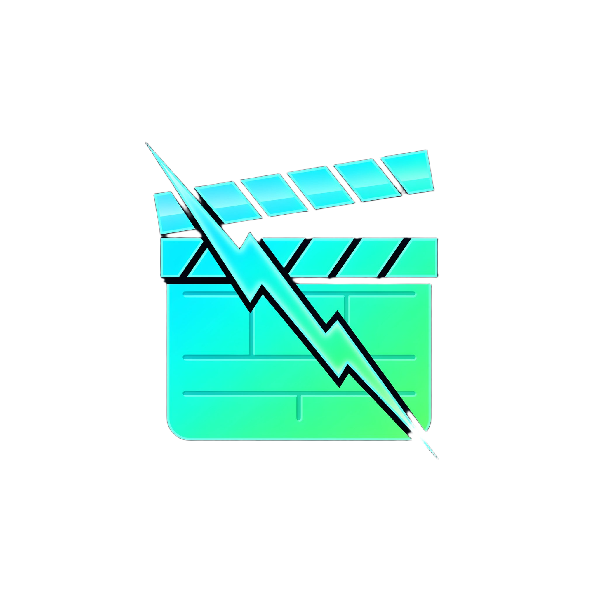

<div align="center">



# Snipflux

**Offline AI Clipping Studio**  
*Transform Full-Length Videos & Streams into Viral 9:16 Shorts with 100% Local AI*

[](releases)
[](#download)
[](#)
[](#)

---

### ⚡ Download Latest Release

<a href="https://github.com/aaziprojects/Snipflux/releases/latest/download/Snipflux-Windows.exe">
  
</a>
&nbsp;&nbsp;
<a href="https://github.com/aaziprojects/Snipflux/releases/latest/download/Snipflux-macOS.zip">
  
</a>

<br/><br/>

*Zero dependencies. Zero terminal commands. Double-click and start clipping.*

---

</div>

## 🌟 Key Features

- **📁 Custom Export Directory**: Choose any destination folder on your drive with a single click. Finished clips, high-res thumbnails (`thumb_X.jpg`), and copy-paste ready title packages (`titles.txt`) save directly where you want them.
- **🎯 Dynamic Face-Tracking & Streamer Framing**: Automatically detects streamer facecams across all corners and dynamically centers speakers with smooth exponential damping. Full support for single-creator and dual-speaker collaboration layouts.
- **⚡ Kinetic Karaoke Captions**: Studio-grade, word-synced subtitles burned into your clips with emotion color-coding, pop animations, and hook banners.
- **🚀 Universal GPU / CPU Acceleration**: Blazing-fast Whisper transcription powered by NVIDIA CUDA GPU acceleration with automatic, seamless fallback to CPU mode (`int8`) on any system.
- **✂️ Smart Silence Trimming**: Detects and cleanly eliminates dead-air pauses >1.6s using 30ms audio micro-crossfades for smooth, seamless retention pacing.
- **💥 Impact Accents & SFX**: Automatically injects whooshes and bass drops at peak viral moments to hook viewers in the first 3 seconds.

---

## 🚀 Quick Start Guide (3 Simple Steps)

You don't need Python, Git, or command-line tools to use Snipflux.

```
┌─────────────────┐       ┌─────────────────┐       ┌─────────────────┐
│  1. Launch App  │  ──►  │ 2. Set URL & Dir│  ──►  │ 3. Generate!    │
└─────────────────┘       └─────────────────┘       └─────────────────┘
```

### 1️⃣ Launch Snipflux
Download **`Snipflux-Windows.exe`** (Windows) or **`Snipflux-macOS.zip`** (macOS) from the release buttons above and open the application.

### 2️⃣ Paste Video URL & Choose Export Folder
- Paste your YouTube video, Twitch VOD, or local video path into the **Stream URL** box.
- Under **Output / Export Folder**, click **Browse Folder** to pick where your clips will be saved.
- *(Optional)* Choose a Quick Preset (🎮 Gaming, 🎙 Podcast, ⚡ Fast Cut) or enter a Topic Prompt (e.g., *"funny fails"*).

### 3️⃣ Click "Generate Clips"
Hit the **⚡ Generate Clips** button. Snipflux will:
1. Download and analyze the audio.
2. Identify high-energy viral moments using 3-layer engagement scoring.
3. Track and frame speakers in portrait 9:16 format.
4. Burn kinetic captions and retention effects.
5. Save your clips and ready-to-upload titles in your selected export folder.

---

<div align="center">

**Snipflux v2.2.0 — Offline AI Clipping Studio**  
*Create faster. Clip smarter. 100% private on your own hardware.*

</div>
