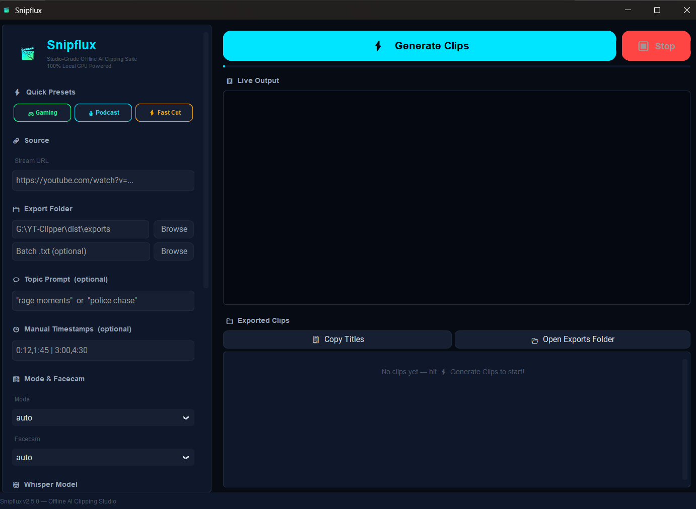
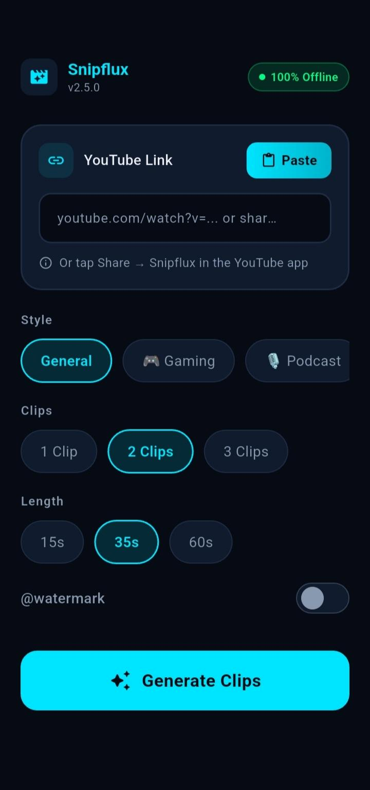

<div align="center">


# Snipflux

**Offline AI Clipping Studio**  
*Transform Full-Length Videos & Streams into Viral 9:16 Shorts with 100% Local AI*

[](../../releases)
[](#download)
[](#)
[](#)

---

### ⚡ Download Latest Release

<a href="https://github.com/aaziprojects/Snipflux/releases/latest/download/Snipflux-Windows.zip">
  
</a>
&nbsp;&nbsp;
<a href="https://github.com/aaziprojects/Snipflux/releases/latest/download/Snipflux-macOS.zip">
  
</a>
<br/><br/>
<a href="https://github.com/aaziprojects/Snipflux/releases/latest/download/Snipflux-Android-APKs.zip">
  
</a>
<br/><br/>

*Zero dependencies. Zero cloud subscriptions. 100% private offline AI on desktop & mobile.*

---

</div>

## 🖥️ Studio & Mobile Preview

<table width="100%" style="border-collapse: collapse; border: none;">
  <tr style="border: none;">
    <td width="68%" align="center" valign="top" style="border: none; padding: 10px;">
      <h3 align="center">🖥️ Desktop Studio UI (Web Dashboard)</h3>
      <a href="assets/desktop-preview.png"></a>
      <p align="center"><em>High-contrast dark-mode dashboard with one-click presets, CUDA/VideoToolbox acceleration, and real-time viral clip generation.</em></p>
    </td>
    <td width="32%" align="center" valign="top" style="border: none; padding: 10px;">
      <h3 align="center">📱 Mobile Studio (Android)</h3>
      <a href="assets/mobile-preview.png"></a>
      <p align="center"><em>Pocket-sized on-device AI clipping studio: on-device Whisper, MediaCodec hardware rendering, and instant YouTube share-sheet receiver.</em></p>
    </td>
  </tr>
</table>

---

## 🌟 Key Features

- **📁 Custom Export Directory**: Choose any destination folder on your drive with a single click. Finished clips, high-res thumbnails (`thumb_X.jpg`), and copy-paste ready title packages (`titles.txt`) save directly where you want them.
- **🎯 Dynamic Face-Tracking & Streamer Framing**: Automatically detects streamer facecams across all corners and dynamically centers speakers with smooth exponential damping. Full support for single-creator and dual-speaker collaboration layouts.
- **⚡ Kinetic Karaoke Captions**: Studio-grade, word-synced subtitles burned into your clips with emotion color-coding, pop animations, and hook banners.
- **🚀 Universal GPU / CPU Acceleration**: Blazing-fast Whisper transcription powered by NVIDIA CUDA GPU acceleration with automatic, seamless fallback to CPU mode (`int8`) on any system.
- **✂️ Smart Silence Trimming**: Detects and cleanly eliminates dead-air pauses >1.6s using 30ms audio micro-crossfades for smooth, seamless retention pacing.
- **💥 Impact Accents & SFX**: Automatically injects whooshes and bass drops at peak viral moments to hook viewers in the first 3 seconds.

---

### 📱 Mobile App Highlights (Android)

- **🧠 3–4 GB RAM Low-Memory Engine**: Quantized on-device speech AI (`whisper.cpp` / `whisper_flutter_new`) with 30-second sliding chunk processing that caps peak RAM strictly under **350 MB**—runs smoothly on budget phones without triggering Android's Out-Of-Memory (OOM) killer.
- **🛡️ Pre-Download Storage Guard**: Scans required space (`streamSize * 2.5 + 300 MB` buffer) against available device storage before downloading; warns and blocks low-storage errors before they happen.
- **📲 YouTube Share-Sheet Integration**: Tap *Share → Snipflux* directly within YouTube or your mobile browser to load and clip streams in one touch.
- **⚡ Hardware-Accelerated 9:16 Video Pipeline**: Employs Android `h264_mediacodec` hardware encoders for rapid rendering without thermal throttling.
- **💾 1-Tap Save to Gallery & Social Export**: Dedicated vertical 9:16 reels player with instant one-tap **Save to Camera Roll / Gallery** and direct sharing to **TikTok, YouTube Shorts, and Instagram Reels**.

---

## 🚀 Quick Start Guide (3 Simple Steps)

You don't need Python, Git, or command-line tools to use Snipflux.

```
┌─────────────────┐       ┌─────────────────┐       ┌─────────────────┐
│  1. Launch App  │  ──►  │ 2. Set URL & Dir│  ──►  │ 3. Generate!    │
└─────────────────┘       └─────────────────┘       └─────────────────┘
```

### 1️⃣ Launch Snipflux
- **Desktop (Windows/macOS):** Download **`Snipflux-Windows.zip`** (Windows) or **`Snipflux-macOS.zip`** (macOS) from the release buttons above and open the application.
- **Android:** Download **`Snipflux-Android-APKs.zip`**, open the file, extract it and tap **Install** (enable *Install Unknown Apps* if prompted), and grant media permissions.

### 2️⃣ Paste Video URL & Choose Export Folder
- Paste your YouTube video, Twitch VOD, or local video path into the **Stream URL** box (or tap **Share → Snipflux** on your phone).
- Under **Output / Export Folder**, click **Browse Folder** to pick where your clips will be saved (mobile defaults cleanly to your app Documents and allows instant 1-tap Camera Roll export).
- *(Optional)* Choose a Quick Preset (🎮 Gaming, 🎙 Podcast, ⚡ Fast Cut) or enter a Topic Prompt (e.g., *"funny fails"*).

### 3️⃣ Click "Generate Clips"
Hit the **⚡ Generate Clips** button. Snipflux will:
1. Download and analyze the audio.
2. Identify high-energy viral moments using 3-layer engagement scoring.
3. Track and frame speakers in portrait 9:16 format.
4. Burn kinetic captions and retention effects.
5. Save your clips and ready-to-upload titles in your selected export folder (or preview in the mobile 9:16 reels player).

---

<div align="center">

**Snipflux v2.5.0 — Offline AI Clipping Studio**  
*Create faster. Clip smarter. 100% private on your own hardware.*

</div>
